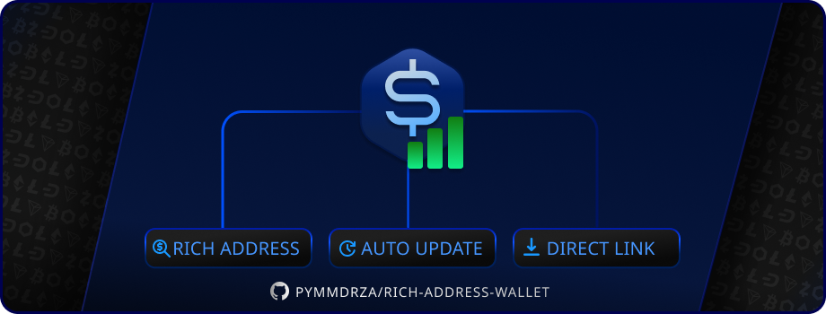

# Rich Address Wallet

[]() []()  []() []() [
]()




---

### Latest Update

[&color=F58025)](https://github.com/Pymmdrza/Rich-Address-Wallet/releases/tag/bitcoin-rich-list)


- Latest Bitcoin Addresses __(Any Type)__
- Latest Rich Bitcoin Address Type : **P2PKH** (Start with 1)
- Latest Rich Bitcoin Address Type : **P2SH** (Start with 3)
- Latest Rich Bitcoin Address Type : **BECH32** (Start with bc1)
- Latest Rich Bitcoin (Type : **P2PKH** & **P2SH** & **BECH32**)
- Latest Litecoin Addresses Type : **All**
- Latest Rich Litecoin Addresses Type : **Minimum `0.1 LTC`**
- Latest Dogecoin Addresses Type : **All**
- Latest Rich Dogecoin Addresses Type : **Minimum `0.1 DOGE`**
- Latest DASH Addresses Type : **All**
- Latest Rich DASH Addresses Type : **Minimum `0.1 DASH`**
- Latest Bitcoin Cash Addresses Type : **All**
- Latest Rich Bitcoin Cash Addresses Type : **Minimum `0.1 BCH`**


## Dataset Overview

This repository provides an automatically generated, up-to-date snapshot of **funded and high-balance (rich) Bitcoin addresses**, organized by script type and **sorted in descending order by balance** (richest addresses first). Ideal for blockchain analytics, UTXO distribution research, wallet indexing, and data science.

> [!NOTE]
> All dataset archives and direct mirror links (**GitHub Releases** and **MegaS4 Direct S3 Mirror**) are hosted on the [**`bitcoin-rich-list` Release Page**](https://github.com/Pymmdrza/Rich-Address-Wallet/releases/tag/bitcoin-rich-list).
> Each dataset across standard spendable address types (`1...`, `3...`, `bc1q...`, `bc1p...`) is available in two formats:
> - **With Balances (`.txt.gz`)**: Compressed in standard **Gzip (`.gz`)** format following the `address,balance` CSV schema with balances denominated in **BTC (8 decimal places)**.
> - **Only Address (`.txt` / `.txt.gz`)**: Contains **only Bitcoin addresses** (one address per line, without headers or balances), preserving the descending balance order (available as `.txt` on GitHub and `.txt.gz` on MegaS4 S3).

---

 All files, latest snapshot updates, exact file sizes, and direct download mirrors (**GitHub** & **MegaS4 S3**) are available in the [**Latest Release (`bitcoin-rich-list`)**](https://github.com/Pymmdrza/Rich-Address-Wallet/releases/tag/bitcoin-rich-list).

<table>
  <thead>
    <tr>
      <th align="left">Available Datasets &mdash; Sorted by Balance (DESC) &bull; Hosted on GitHub Releases &amp; MegaS4 S3 Mirror</th>
    </tr>
  </thead>
  <tbody>
    <tr>
      <td>
        <strong>Master Dataset &mdash; All Standard Rich Bitcoin Addresses</strong> &nbsp; <kbd>1...</kbd> <kbd>3...</kbd> <kbd>bc1q...</kbd> <kbd>bc1p...</kbd><br>
        <sub>Complete combined dataset across every standard spendable Bitcoin address format. &bull; Unit: <a href="https://en.wikipedia.org/wiki/Bitcoin"><strong>BTC</strong></a> (8 decimals) &bull; Order: <a href="https://en.wikipedia.org/wiki/Unspent_transaction_output"><strong>Balance DESC</strong></a> &bull; Schema: <code>address,balance</code> / Only Address</sub><br>
        <sub>Included Files: <code>Latest_Rich_Bitcoin_Addresses.txt.gz</code> &bull; <code>Latest_Rich_Bitcoin_Addresses_Only.txt</code> (<code>.gz</code> on S3)</sub><br><br>
        <a href="https://github.com/Pymmdrza/Rich-Address-Wallet/releases/tag/bitcoin-rich-list"></a>
      </td>
    </tr>
    <tr>
      <td>
        <strong>Legacy Addresses (P2PKH)</strong> &nbsp; <kbd>1...</kbd><br>
        <sub>Original Pay-to-PubKey-Hash Bitcoin addresses commonly found in early wallets and historical cold storage. &bull; Type: <a href="https://en.wikipedia.org/wiki/Cryptocurrency_wallet"><strong>P2PKH</strong></a> &bull; Encoding: <a href="https://en.wikipedia.org/wiki/Binary-to-text_encoding#Base58"><strong>Base58Check</strong></a> &bull; Unit: <strong>BTC</strong> (DESC)</sub><br>
        <sub>Included Files: <code>Latest_Rich_Bitcoin_P2PKH_Addresses.txt.gz</code> &bull; <code>Latest_Rich_Bitcoin_P2PKH_Addresses_Only.txt</code> (<code>.gz</code> on S3)</sub><br><br>
        <a href="https://github.com/Pymmdrza/Rich-Address-Wallet/releases/tag/bitcoin-rich-list"></a>
      </td>
    </tr>
    <tr>
      <td>
        <strong>Script &amp; Multi-Sig Addresses (P2SH)</strong> &nbsp; <kbd>3...</kbd><br>
        <sub>Pay-to-Script-Hash addresses widely used for institutional multi-signature vaults, exchanges, and Wrapped SegWit wallets. &bull; Type: <a href="https://github.com/bitcoin/bips/blob/master/bip-0013.mediawiki"><strong>P2SH</strong></a> &bull; Standard: <a href="https://github.com/bitcoin/bips/blob/master/bip-0016.mediawiki"><strong>BIP-16</strong></a> &bull; Unit: <strong>BTC</strong> (DESC)</sub><br>
        <sub>Included Files: <code>Latest_Rich_Bitcoin_P2SH_Addresses.txt.gz</code> &bull; <code>Latest_Rich_Bitcoin_P2SH_Addresses_Only.txt</code> (<code>.gz</code> on S3)</sub><br><br>
        <a href="https://github.com/Pymmdrza/Rich-Address-Wallet/releases/tag/bitcoin-rich-list"></a>
      </td>
    </tr>
    <tr>
      <td>
        <strong>Native SegWit v0 Addresses (P2WPKH / P2WSH)</strong> &nbsp; <kbd>bc1q...</kbd><br>
        <sub>Modern Bech32 addresses engineered for lower transaction fees, covering single-sig and SegWit script wallets. &bull; Type: <a href="https://en.wikipedia.org/wiki/SegWit"><strong>P2WPKH / P2WSH</strong></a> &bull; Encoding: <a href="https://github.com/bitcoin/bips/blob/master/bip-0173.mediawiki"><strong>Bech32 (BIP-173)</strong></a> &bull; Unit: <strong>BTC</strong> (DESC)</sub><br>
        <sub>Included Files: <code>Latest_Rich_Bitcoin_P2WPKH_P2WSH_Addresses.txt.gz</code> &bull; <code>Latest_Rich_Bitcoin_P2WPKH_P2WSH_Addresses_Only.txt</code> (<code>.gz</code> on S3)</sub><br><br>
        <a href="https://github.com/Pymmdrza/Rich-Address-Wallet/releases/tag/bitcoin-rich-list"></a>
      </td>
    </tr>
    <tr>
      <td>
        <strong>Taproot / SegWit v1 Addresses (P2TR)</strong> &nbsp; <kbd>bc1p...</kbd><br>
        <sub>Latest-generation Taproot addresses featuring Schnorr signature efficiency, improved privacy, and smart-contract capabilities. &bull; Type: <a href="https://bitcoinops.org/en/topics/taproot/"><strong>P2TR</strong></a> &bull; Encoding: <a href="https://github.com/bitcoin/bips/blob/master/bip-0341.mediawiki"><strong>Bech32m (BIP-341)</strong></a> &bull; Unit: <strong>BTC</strong> (DESC)</sub><br>
        <sub>Included Files: <code>Latest_Rich_Bitcoin_P2TR_Addresses.txt.gz</code> &bull; <code>Latest_Rich_Bitcoin_P2TR_Addresses_Only.txt</code> (<code>.gz</code> on S3)</sub><br><br>
        <a href="https://github.com/Pymmdrza/Rich-Address-Wallet/releases/tag/bitcoin-rich-list"></a>
      </td>
    </tr>
  </tbody>
</table>

---

## Quick Usage & Schema

<details>
<summary><strong>Schema Preview &amp; Quick Start (CLI / Python)</strong></summary>

### 1. With Balances (`Latest_Rich_Bitcoin_*.txt.gz`)
Each `Latest_Rich_Bitcoin_*.txt.gz` file uses the following CSV structure with balances in **BTC** (exact 8 decimal places, sorted highest to lowest):

```csv
address,balance
34xp4vRoCGJym3xR7yCVPFHoCNxv4Twseo,248597.59296803
3M219KR5vEneNb47ewrPfWyb5jQ2DjxRP6,160491.13444231
bc1qgdjqv0av3q56jvd82tkdjpy7gdp9ut8tlqmgrpmv24sq90ecnvqqjwvw97,157010.08337263
```

### 2. Only Address (`Latest_Rich_Bitcoin_*_Only.txt` / `.txt.gz`)
Each `*_Only` file contains one address per line (without header or balance), sorted in the same descending balance order:

```text
34xp4vRoCGJym3xR7yCVPFHoCNxv4Twseo
3M219KR5vEneNb47ewrPfWyb5jQ2DjxRP6
bc1qgdjqv0av3q56jvd82tkdjpy7gdp9ut8tlqmgrpmv24sq90ecnvqqjwvw97
```

## Download & Decompress via CLI:

> All file links and mirror URLs can be found on the [**`bitcoin-rich-list` Release Page**](https://github.com/Pymmdrza/Rich-Address-Wallet/releases/tag/bitcoin-rich-list).

```shell
# With balances (.txt.gz) — GitHub or MegaS4 S3 direct mirror
curl -LO https://github.com/Pymmdrza/Rich-Address-Wallet/releases/download/bitcoin-rich-list/Latest_Rich_Bitcoin_Addresses.txt.gz
# or via MegaS4 S3 mirror:
# curl -LO https://s3.g.megas4.com/bkbacispjefgmcy4vd4zung44locwlpvrij7w/release/bitcoin/Latest_Rich_Bitcoin_Addresses.txt.gz
gunzip -k Latest_Rich_Bitcoin_Addresses.txt.gz

# Only addresses — GitHub (.txt) or MegaS4 S3 (.txt.gz)
curl -LO https://github.com/Pymmdrza/Rich-Address-Wallet/releases/download/bitcoin-rich-list/Latest_Rich_Bitcoin_Addresses_Only.txt
# or compressed via MegaS4 S3 mirror:
# curl -LO https://s3.g.megas4.com/bkbacispjefgmcy4vd4zung44locwlpvrij7w/release/bitcoin/Latest_Rich_Bitcoin_Addresses_Only.txt.gz
# gunzip -k Latest_Rich_Bitcoin_Addresses_Only.txt.gz
```

## Load directly in Python:

```python
import gzip
import pandas as pd

# Load compressed CSV with balances
df = pd.read_csv("Latest_Rich_Bitcoin_Addresses.txt.gz", compression="gzip")
print(df.head(10))

# Read Only-Address plain text file (.txt)
with open("Latest_Rich_Bitcoin_Addresses_Only.txt", "r", encoding="utf-8") as f:
    top_addresses = [next(f).strip() for _ in range(10)]
print(top_addresses)

# Or read compressed Only-Address file (.txt.gz) directly without extracting
with gzip.open("Latest_Rich_Bitcoin_Addresses_Only.txt.gz", "rt", encoding="utf-8") as f:
    top_addresses_gz = [next(f).strip() for _ in range(10)]
print(top_addresses_gz)
```
</details>


---

### Cryptocurrencies Rich Address Wallet
|          | Symbol                                                                     | Latest                                                                      |
|----------|----------------------------------------------------------------------------|-----------------------------------------------------------------------------|
| Bitcoin  | [BTC](https://github.com/Pymmdrza/Rich-Address-Wallet/tree/main/Bitcoin)   | [Release](https://github.com/Pymmdrza/Rich-Address-Wallet/releases/tag/Bitcoin) |
| Ethereum | [ETH](https://github.com/Pymmdrza/Rich-Address-Wallet/tree/main/ETHEREUM)  | [Release](https://github.com/Pymmdrza/Rich-Address-Wallet/releases/latest/) |
| Litecoin | [LTC](https://github.com/Pymmdrza/Rich-Address-Wallet/tree/main/LITECOIN)  | [Release](https://github.com/Pymmdrza/Rich-Address-Wallet/releases/tag/Litecoin) |
| Dogecoin | [DOGE](https://github.com/Pymmdrza/Rich-Address-Wallet/tree/main/Dogecoin) | [Release](https://github.com/Pymmdrza/Rich-Address-Wallet/releases/latest/) |
| Tron     | [TRX](https://github.com/Pymmdrza/Rich-Address-Wallet/tree/main/TRON)      | [Release](https://github.com/Pymmdrza/Rich-Address-Wallet/releases/latest/) |
| Solana   | -                                                                          | -                                                                           |
| Polkadot | [DOT](https://github.com/Pymmdrza/Rich-Address-Wallet/tree/main/DOT)       | [Release](https://github.com/Pymmdrza/Rich-Address-Wallet/releases/latest/) |
| zCash    | [ZEC](https://github.com/Pymmdrza/Rich-Address-Wallet/tree/main/ZCASH)     | [Release](https://github.com/Pymmdrza/Rich-Address-Wallet/releases/latest/) |

---

## Download Software : Rich Address Downloader V2 🆕


[](https://github.com/Pymmdrza/RichAddressDownloader) [](https://github.com/Pymmdrza/RichAddressDownloader/releases)

---

### Example Of Rich Bitcoin Address

| Address                                                          | Balance (`BTC`)    | Explorer                                                                                                       |
|------------------------------------------------------------------|--------------------|----------------------------------------------------------------------------------------------------------------|
| `34xp4vRoCGJym3xR7yCVPFHoCNxv4Twseo`                             | `248,597.38632561` | [Check](https://blockchair.com/bitcoin/address/34xp4vRoCGJym3xR7yCVPFHoCNxv4Twseo)                             |
| `bc1qgdjqv0av3q56jvd82tkdjpy7gdp9ut8tlqmgrpmv24sq90ecnvqqjwvw97` | `178,010.0882228`  | [Check](https://blockchair.com/bitcoin/address/bc1qgdjqv0av3q56jvd82tkdjpy7gdp9ut8tlqmgrpmv24sq90ecnvqqjwvw97) |
| `1LQoWist8KkaUXSPKZHNvEyfrEkPHzSsCd`                             | `119,347.40521397` | [Check](https://blockchair.com/bitcoin/address/1LQoWist8KkaUXSPKZHNvEyfrEkPHzSsCd)                             |
| `38Xnrq8MZiKmYmwobbYdZQ5nnCbX1qvQfE`                             | `117,351.05645141` | [Check](https://blockchair.com/bitcoin/address/38Xnrq8MZiKmYmwobbYdZQ5nnCbX1qvQfE)                             |
| `bc1qazcm763858nkj2dj986etajv6wquslv8uxwczt`                     | `94,643.30613354`  | [Check](https://blockchair.com/bitcoin/address/bc1qazcm763858nkj2dj986etajv6wquslv8uxwczt)                     |
| `37XuVSEpWW4trkfmvWzegTHQt7BdktSKUs`                             | `94,505.3435766`   | [Check](https://blockchair.com/bitcoin/address/37XuVSEpWW4trkfmvWzegTHQt7BdktSKUs)                             |
| `1FeexV6bAHb8ybZjqQMjJrcCrHGW9sb6uF`                             | `79,957.25311101`  | [Check](https://blockchair.com/bitcoin/address/1FeexV6bAHb8ybZjqQMjJrcCrHGW9sb6uF)                             |
| `bc1qa5wkgaew2dkv56kfvj49j0av5nml45x9ek9hz6`                     | `69,370.17883259`  | [Check](https://blockchair.com/bitcoin/address/bc1qa5wkgaew2dkv56kfvj49j0av5nml45x9ek9hz6)                     |
| `3LYJfcfHPXYJreMsASk2jkn69LWEYKzexb`                             | `68,200.00432924`  | [Check](https://blockchair.com/bitcoin/address/3LYJfcfHPXYJreMsASk2jkn69LWEYKzexb)                             |
| `bc1qd4ysezhmypwty5dnw7c8nqy5h5nxg0xqsvaefd0qn5kq32vwnwqqgv4rzr` | `59,300.08307523`  | [Check](https://blockchair.com/bitcoin/address/bc1qd4ysezhmypwty5dnw7c8nqy5h5nxg0xqsvaefd0qn5kq32vwnwqqgv4rzr) |
| `1LdRcdxfbSnmCYYNdeYpUnztiYzVfBEQeC`                             | `53,880.06275164`  | [Check](https://blockchair.com/bitcoin/address/1LdRcdxfbSnmCYYNdeYpUnztiYzVfBEQeC)                             |
| `bc1qjasf9z3h7w3jspkhtgatgpyvvzgpa2wwd2lr0eh5tx44reyn2k7sfc27a4` | `53,492.39615503`  | [Check](https://blockchair.com/bitcoin/address/bc1qjasf9z3h7w3jspkhtgatgpyvvzgpa2wwd2lr0eh5tx44reyn2k7sfc27a4) |
| `1AC4fMwgY8j9onSbXEWeH6Zan8QGMSdmtA`                             | `51,830.4004163`   | [Check](https://blockchair.com/bitcoin/address/1AC4fMwgY8j9onSbXEWeH6Zan8QGMSdmtA)                             |
| `1LruNZjwamWJXThX2Y8C2d47QqhAkkc5os`                             | `44,000.08675574`  | [Check](https://blockchair.com/bitcoin/address/1LruNZjwamWJXThX2Y8C2d47QqhAkkc5os)                             |
| `38DN2uFMZPiHLHJigfv4kWC9JWJrNnhLcn`                             | `40,041.05259302`  | [Check](https://blockchair.com/bitcoin/address/38DN2uFMZPiHLHJigfv4kWC9JWJrNnhLcn)                             |
| `3LCGsSmfr24demGvriN4e3ft8wEcDuHFqh`                             | `39,953.51795716`  | [Check](https://blockchair.com/bitcoin/address/3LCGsSmfr24demGvriN4e3ft8wEcDuHFqh)                             |
| `3LQUu4v9z6KNch71j7kbj8GPeAGUo1FW6a`                             | `37,926.97771319`  | [Check](https://blockchair.com/bitcoin/address/3LQUu4v9z6KNch71j7kbj8GPeAGUo1FW6a)                             |
| `3M219KR5vEneNb47ewrPfWyb5jQ2DjxRP6`                             | `37,326.42365118`  | [Check](https://blockchair.com/bitcoin/address/3M219KR5vEneNb47ewrPfWyb5jQ2DjxRP6)                             |
| `bc1q7ydrtdn8z62xhslqyqtyt38mm4e2c4h3mxjkug`                     | `36,000.42223604`  | [Check](https://blockchair.com/bitcoin/address/bc1q7ydrtdn8z62xhslqyqtyt38mm4e2c4h3mxjkug)                     |
| `bc1qjh0akslml59uuczddqu0y4p3vj64hg5mc94c40`                     | `33,217.70284909`  | [Check](https://blockchair.com/bitcoin/address/bc1qjh0akslml59uuczddqu0y4p3vj64hg5mc94c40)                     |
| `12XqeqZRVkBDgmPLVY4ZC6Y4ruUUEug8Fx`                             | `32,321.00051856`  | [Check](https://blockchair.com/bitcoin/address/12XqeqZRVkBDgmPLVY4ZC6Y4ruUUEug8Fx)                             |
| `bc1qx9t2l3pyny2spqpqlye8svce70nppwtaxwdrp4`                     | `31,643.38388706`  | [Check](https://blockchair.com/bitcoin/address/bc1qx9t2l3pyny2spqpqlye8svce70nppwtaxwdrp4)                     |
| `3FHNBLobJnbCTFTVakh5TXmEneyf5PT61B`                             | `31,275.3505938`   | [Check](https://blockchair.com/bitcoin/address/3FHNBLobJnbCTFTVakh5TXmEneyf5PT61B)                             |
| `12ib7dApVFvg82TXKycWBNpN8kFyiAN1dr`                             | `31,000.0732843`   | [Check](https://blockchair.com/bitcoin/address/12ib7dApVFvg82TXKycWBNpN8kFyiAN1dr)                             |
| `bc1qm34lsc65zpw79lxes69zkqmk6ee3ewf0j77s3h`                     | `30,383.03843011`  | [Check](https://blockchair.com/bitcoin/address/bc1qm34lsc65zpw79lxes69zkqmk6ee3ewf0j77s3h)                     |
| `bc1qf2yvj48mzkj7uf8lc2a9sa7w983qe256l5c8fs`                     | `30,174.70360176`  | [Check](https://blockchair.com/bitcoin/address/bc1qf2yvj48mzkj7uf8lc2a9sa7w983qe256l5c8fs)                     |
| `12tkqA9xSoowkzoERHMWNKsTey55YEBqkv`                             | `28,151.05862779`  | [Check](https://blockchair.com/bitcoin/address/12tkqA9xSoowkzoERHMWNKsTey55YEBqkv)                             |
| `38UmuUqPCrFmQo4khkomQwZ4VbY2nZMJ67`                             | `27,066.97292147`  | [Check](https://blockchair.com/bitcoin/address/38UmuUqPCrFmQo4khkomQwZ4VbY2nZMJ67)                             |
| `3MgEAFWu1HKSnZ5ZsC8qf61ZW18xrP5pgd`                             | `26,841.3`         | [Check](https://blockchair.com/bitcoin/address/3MgEAFWu1HKSnZ5ZsC8qf61ZW18xrP5pgd)                             |
| `1aXzEKiDJKzkPxTZy9zGc3y1nCDwDPub2`                              | `25,640.38996033`  | [Check](https://blockchair.com/bitcoin/address/1aXzEKiDJKzkPxTZy9zGc3y1nCDwDPub2)                              |
| `bc1qjysjfd9t9aspttpjqzv68k0ydpe7pvyd5vlyn37868473lell5tqkz456m` | `25,085.7648675`   | [Check](https://blockchair.com/bitcoin/address/bc1qjysjfd9t9aspttpjqzv68k0ydpe7pvyd5vlyn37868473lell5tqkz456m) |
| `17MWdxfjPYP2PYhdy885QtihfbW181r1rn`                             | `24,495.35054524`  | [Check](https://blockchair.com/bitcoin/address/17MWdxfjPYP2PYhdy885QtihfbW181r1rn)                             |

---

## Support & Donate

If this dataset helps your research, analytics, or project, please consider starring the repository or sending a donation to help keep the automated updates running:


Bitcoin (BTC) Donation Address:

[](#support--donate 'Bitcoin Wallet Address')

---

- Website : [Mmdrza.Com](https://mmdrza.com)
- Telegram Channel : [Crypto2ools](https://crypto2ools.t.me)
- Telegram ID : [Mr1Mmdrza](https://mr1mmdrza.t.me)
- Email : [a.i@Programmer.net](mailto:a.i@programmer.net) | [first@Programmer.net](mailto:first@programmer.net)

---

### Star History

<p align="center">
<a href="https://star-history.com/#Pymmdrza/rich-address-wallet&Date">
  
</a>
</p>
